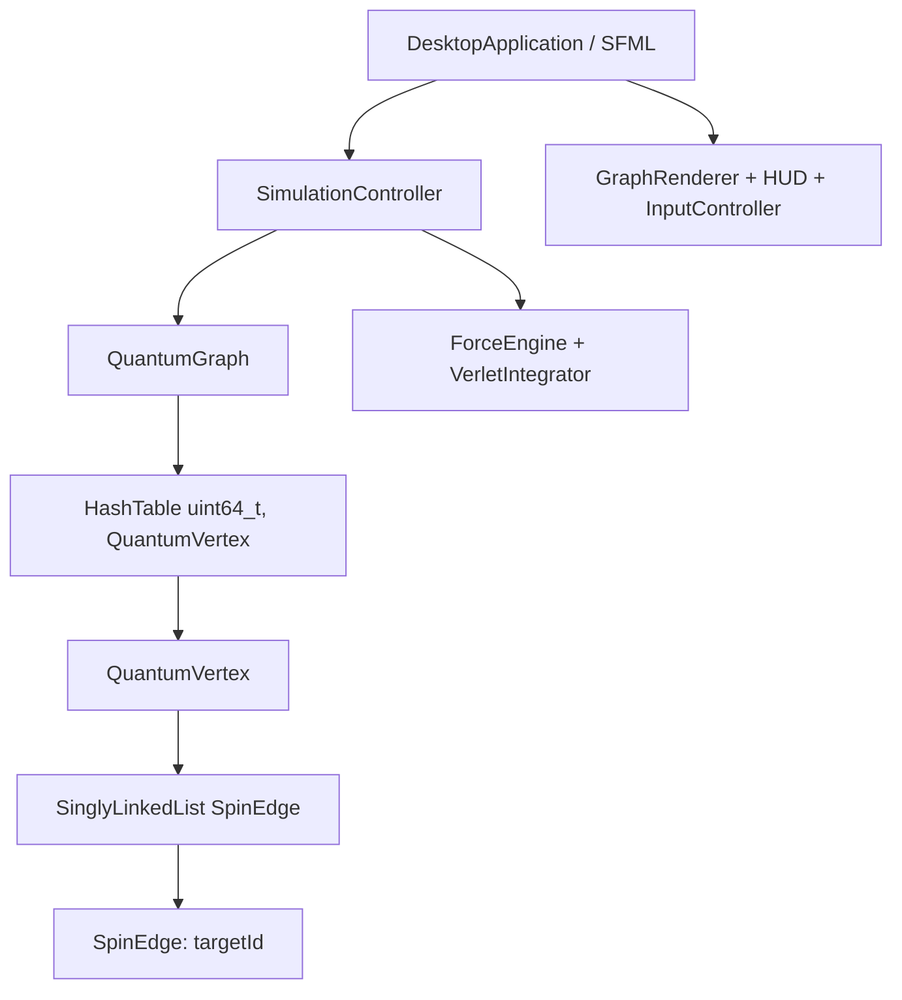

# Arquitectura y contratos — Workshop 1

La columna vertebral de las dos entregas es **Hash → Lista simple → Grafo → SFML → Lista doble → Historial → Invariantes**. Los primeros cuatro componentes y la física forman el avance; los últimos tres se integrarán en el producto final.

## Propiedad y memoria

Los nodos de hash poseen valores y siguientes nodos mediante `unique_ptr`. Cada vértice posee su lista de adyacencias. La lista posee su cabeza y enlaces siguientes; la cola es un puntero observador. Las aristas contienen IDs y parámetros, nunca punteros a vértices.

El grafo es simple y no dirigido: rechaza lazos, duplicados y extremos inexistentes. Una arista lógica tiene dos registros de adyacencia con el mismo ID. `edgeCount()` / `numberOfEdges()` cuenta una arista una sola vez. Eliminar un vértice elimina sus registros recíprocos.

Las copias existentes son profundas. Los movimientos dejan los objetos fuente vacíos y reutilizables. La destrucción de cadenas es iterativa, sin `new` / `delete` manuales. Los punteros de `findVertex` son observadores; eliminación, rehash y asignación pueden invalidarlos. El motor de fuerzas sólo conserva observadores durante una llamada sin edición del grafo. El controlador conserva IDs, nunca punteros entre frames.

La edición externa de `edges` no está permitida: usa `addEdge` y `removeEdge` para preservar simetría. `addVertex(const QuantumVertex&)` acepta únicamente vértices aislados con valores físicos válidos. `addVertex(id, position, mass)` crea uno aislado. Los nombres cortos originales `size`, `edgeCount` y `contains` se conservan como aliases de la API del avance.

## Hash y lista

FNV-1a parte de 14695981039346656037, aplica XOR por byte y multiplica por 1099511628211, módulo 2^64. El bucket es hash(key) % capacity. Se admiten claves integrales (excepto bool) y cadenas. Los enteros se codifican en little-endian para un resultado independiente de la máquina.

El rehash ocurre antes de superar α=0.75. Se reconstruye una tabla temporal y se intercambia sólo al finalizar. Esta decisión garantiza que una excepción durante la asignación de memoria deje intacta la tabla original; copia también las listas de adyacencia. No se debe asumir que un observador siga válido tras rehash.

La lista incluye `pushFront`, `pushBack`, `remove`, `find`, `contains`, `clear`, `size`, `begin`, `end`, además de `removeIf` para buscar aristas por destino. La igualdad sólo es necesaria al usar búsqueda/eliminación por valor.

## Física C++

Para Δ=x_j−x_i, r=|Δ| y dirección Δ/(r+ε_s), el resorte aplica k_global·k_arista·(r−L)·dirección. Se evalúa una vez por arista lógica, sumando fuerzas iguales y opuestas.

La repulsión por par tiene magnitud k_r/(r²+ε²), ε=5, y dirección alejándose del otro vértice. Si los vértices coinciden, se elige una dirección determinista según los IDs para separarlos sin división por cero. El costo directo es O(V²).

Velocity Verlet divide la actualización de velocidad en dos medios pasos y recalcula fuerzas después de mover posiciones. El amortiguamiento F_damp=−γv se aplica mediante dos factores exp(−γΔt/(2m)), uno a cada lado de Verlet. Es una separación simétrica de operadores; no se trata el amortiguamiento como una fuerza dependiente sólo de posición.

`previousPosition` y `acceleration` se actualizan en el integrador. Un vértice fijo o arrastrado mantiene posición durante la física y tiene velocidad cero. Arrastrar conserva el desplazamiento entre punto de agarre y centro del nodo.

`FixedStepClock` usa Δt=1/120 s. Limita el tiempo de recuperación a 0.1 s (12 pasos). Pausar borra el acumulador y evita recuperar tiempo de pausa. En condiciones sin bloqueos, el resultado no depende de los FPS de renderizado; tras una suspensión prolongada se descarta tiempo deliberadamente.

## Presentación e interacción

`DesktopApplication` administra la ventana y eventos SFML. `InputController` transforma coordenadas de pantalla a mundo, traduce teclado/mouse y administra una cámara; `GraphRenderer` dibuja segmentos, círculos e IDs; `HUD` muestra estado y controles. La física y el controlador son independientes de SFML y se prueban sin pantalla.

`R` reinicia posiciones sin cambiar la topología; `F` sólo encuadra con la cámara. Las teclas `1` y `2` generan 20 o 100 vértices. El límite visual es 500 vértices; no limita la tabla hash. La repulsión cuadrática obliga a medir rendimiento antes de elevarlo.

## Complejidades

| Operación | Promedio | Peor caso / observación |
|---|---|---|
| Lista pushFront / pushBack | O(1) | O(1) |
| Lista find / remove | O(n) | O(n) |
| Hash find / contains / remove | O(1) | O(V) bajo colisiones |
| Hash insert | O(1) amortizado para valores de tamaño constante | Rehash incluye costo de copiar adyacencias |
| Hash rehash | O(V+E) esperado en este grafo | O(V²) con colisiones patológicas y búsquedas de duplicados |
| Grafo hasEdge / removeEdge | O(grado) | Dependiente de cadenas hash |
| RemoveVertex | Depende de grados de vecinos | Vecinos obtienen listas recíprocas para borrar |
| Fuerzas | O(V²+E) esperado | Hash patológico puede encarecer búsqueda de extremos |
| Paso Verlet | O(V²+E) esperado | Dos evaluaciones de fuerzas |
| Renderizado | O(V+E) esperado | Cada arista se dibuja una vez |
| IDs ordenados | O(V log V) | Auxiliar para presets / reinicio |

La STL sirve de infraestructura (`vector` de buckets, buffers, ordenamiento, parámetros opcionales). La hash y las listas enlazadas evaluadas son propias.

## Preparación del Workshop 2

Las métricas conservadas cumplen β₀=C, β₁=E−V+C, χ=V−E y grado medio=2E/V, cero para el grafo vacío. No hay aún historial C++ ni lista doble. La UI final, refinamiento local y las pruebas de historial se implementarán en el segundo workshop.

La demo `site/dist` funciona en JavaScript, sin conexión al núcleo. Su historial de hasta 100 snapshots y su panel de métricas son una demostración complementaria. El dibujo no añade caras: el grafo tetraédrico K4 tiene β₁=3 y no representa un tetraedro sólido ni un movimiento Pachner.
